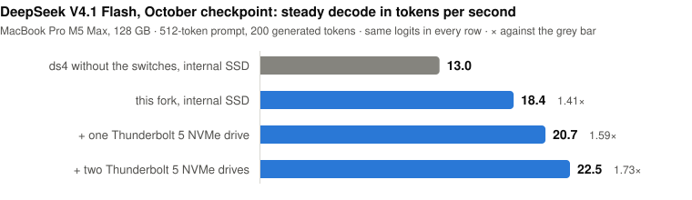
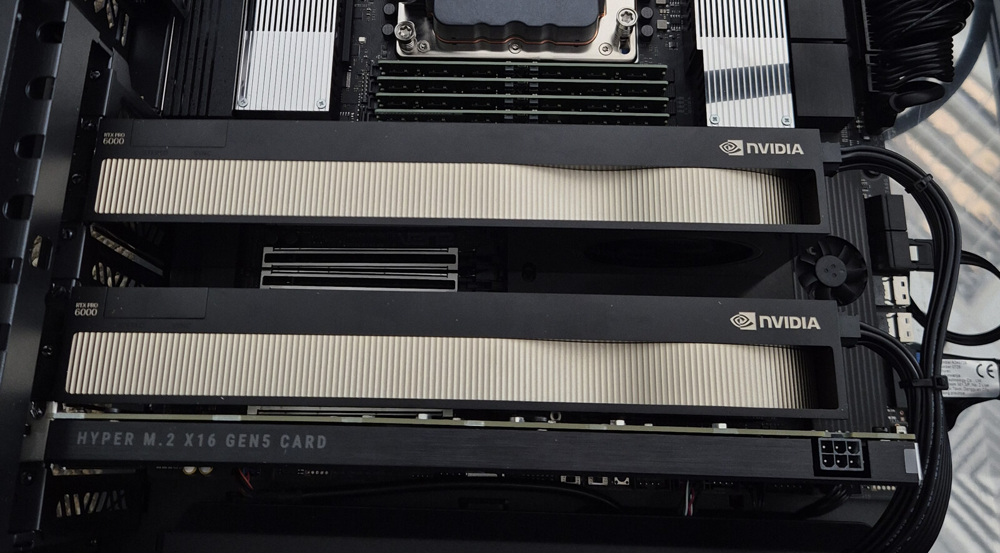

# Argodrive DS4 — Kimi K3.1 Pro and DeepSeek V4.1 Flash 1017

## Run locally on one NVIDIA GPU or on a Mac

**This repository is the inference engine for Kimi K3.1 Pro and DeepSeek V4.1 Flash 1017.** It includes the ds4-based runtime, the Kimi K3/K3.1 CUDA and Metal ports, DeepSeek inference with NVMe streaming optimisations, expert caches and weight-preparation tools. Clone and build this repository; **no separate upstream ds4 installation or Argodrive Mac app is needed**.

This is a **source release**. Model weights, NVIDIA drivers, CUDA build tools (on a Mac, the Xcode command-line tools) and Python dependencies are separate; there is currently no prebuilt installer.

**Choose your model:**

- **Kimi K3.1 Pro:** [installation guide](https://argonautlabs.ai/guides/install-kimi-k31.html) · [CUDA and Metal configuration](tools/kimi-k3/README.md)
- **DeepSeek V4.1 Flash 1017:** [setup, model file and streaming settings](tools/deepseek-v41/README.md) · [one-, two- and three-drive M5 Max results](#deepseek-v41-flash-on-the-same-macbook-pro-macos-metal)
- **Kimi K3.1 Pro on two NVIDIA GPUs:** [results on two RTX PRO 6000](#kimi-k31-pro-on-two-rtx-pro-6000-linux-cuda) · [switches, images and what changed](tools/kimi-k3/README.md#copy-drafts-images-and-both-cards-on-every-layer-24-november-2026)
- **DeepSeek V4.1 Flash 1017 on two NVIDIA GPUs:** [results on two RTX PRO 6000](#deepseek-v41-flash-on-two-rtx-pro-6000-linux-cuda) · [switches and preload lists](tools/deepseek-v41/README.md#cuda-two-gpus-the-layers-split-between-them) · [both cards on every layer](tools/deepseek-v41/README.md#cuda-two-gpus-both-on-every-layer) · [the DSpark drafter, 111 tok/s on JSON](tools/deepseek-v41/README.md#the-dspark-drafter-on-both-cards-22-november)

### Measured results at a glance

The following tables and footprint describe **Kimi K3.1 Pro**. DeepSeek V4.1 Flash 1017 has its own model layout, memory requirements and [benchmark section below](#deepseek-v41-flash-on-the-same-macbook-pro-macos-metal).

| Hardware | Workload | Measured speed | Version and scope |
|---|---|---:|---|
| **Two RTX PRO 6000** (2 x 96 GB, Linux, CUDA) | Raw financial text: 6 prompt / 512 output tokens | **5.54–5.56 tok/s decode** | 25 November, both cards on every layer, Qwen drafter, measured-hot second copies on the fourth drive |
| **Two RTX PRO 6000** (2 x 96 GB, Linux, CUDA) | The same text, no draft model: 6 prompt / 512 output tokens | **3.70–3.71 tok/s decode** | 24 November, both cards on every layer, drafts copied from the context |
| **Two RTX PRO 6000** (2 x 96 GB, Linux, CUDA) | Chat question: 256 output tokens | **3.04 tok/s decode** | 25 November, chat drafter settings; 2.18 on 24 November |
| **Two RTX PRO 6000** (2 x 96 GB, Linux, CUDA) | Code question: 256 output tokens | **2.85–2.86 tok/s decode** | 25 November, chat drafter settings; 1.77 on 24 November |
| **RTX PRO 6000** (96 GB, Linux, CUDA) | Short-prompt chat: 286 prompt / 200 output tokens | **2.01–2.02 tok/s decode** | 11 November, chat drafter settings |
| **RTX PRO 6000** (96 GB, Linux, CUDA) | Raw financial text: 6 prompt / 512 output tokens | **3.77–3.79 tok/s decode** | 11 November, Qwen drafter, fp32 activations |
| **RTX PRO 6000** (96 GB, Linux, CUDA) | Long raw prompt: 512 prompt / 200 output tokens | **3.88–3.89 tok/s decode** | 11 November, Qwen drafter |
| **RTX PRO 6000** (96 GB, Linux, CUDA) | Prompt processing: 1,512-token / 6,769-token prompt | **40.8 / 120 tok/s prefill** | 11 November; not output generation speed |
| **RTX PRO 6000** (96 GB, Linux, CUDA) | Long chat prompts: 6,769 / 13,167 tokens | **1.53 / 1.56 tok/s decode** | 11 November, 8k / 16k context caches |
| **MacBook Pro M5 Max** (128 GB, macOS, Metal) | Raw financial text: 6 prompt / 512 output tokens | **2.49 tok/s decode** | 11 November, Qwen drafter, fp32 activations; 2.29 with the laptop in use |
| **MacBook Pro M5 Max** (128 GB, macOS, Metal) | Prompt processing: 512-token prompt | **9.0–10.4 tok/s prefill** | 11 November; not output generation speed |

**Tested hardware, not minimum requirements:**
- **RTX PRO 6000 (Linux, CUDA):** one RTX PRO 6000 Blackwell GPU with **96 GB VRAM**, **70 GiB RAM** assigned to the Ubuntu VM and **five physical NVMe devices** in three storage tiers (**four** in two tiers for the 10 and 11 November results). Context caches measured up to **16,384 tokens** using sparse attention.
- **Two RTX PRO 6000 (Linux, CUDA):** both cards (96 GB each), **87 GiB RAM** assigned to the Ubuntu VM with a 56 GiB pinned expert pool, and **four physical NVMe devices** in two storage tiers. Contexts measured up to **16,384 tokens**.
- **MacBook Pro (macOS, Metal):** a MacBook Pro with an **M5 Max and 128 GB** of unified memory, its internal SSD and **two Thunderbolt 5 NVMe drives**. Contexts measured up to **2,048 tokens**.
- Both run the same engine on the same **1.45 TB of unique MXFP4 experts**, plus spine, checkpoint and replicas. **Equivalence to Moonshot’s reference implementation remains unvalidated.**

Different machines, prompts and engine versions are separate experiments, not a single controlled speed comparison. [All measurements, definitions and limits](https://argonautlabs.ai/research/kimi-k31-single-gpu.html).

### Footprint: quant, storage and memory

| | RTX PRO 6000 (Linux, CUDA) | MacBook Pro M5 Max (macOS, Metal) |
|---|---|---|
| **Experts** | 82,432 files of 17.5 MB, 1.45 TB: MXFP4 exactly as in Moonshot's checkpoint, not re-quantized | the same files |
| **Spine** (all non-expert weights) | 62 GB of GGUF Q8_0, converted from the checkpoint's BF16, held in VRAM | the same file, held in unified memory |
| **Arithmetic** | fp32 activations, full-precision attention cache, no expert skipping | the same |
| **Storage to run** | the spine and one copy of the experts, about 1.5 TB: one NVMe drive with room for both is enough | the same; the internal SSD alone is enough if it has the room |
| **Storage to prepare** | the checkpoint (about 1.56 TB) plus the outputs: plan on about 3.5 TB free; afterwards the engine reads only the spine and the expert files | the same |
| **Memory** | 96 GB of VRAM for the spine and an expert cache of about 27 GB; 70 GiB of host RAM with a 53.7 GB pinned expert pool (`DS4_K3_CACHE_RAM_GB`) | 128 GB unified: the spine, a 40 GB expert cache (`DS4_K3_CACHE_RAM_GB`) and buffers, at Metal's recommended working set (about 107 GiB) |
| **Measured storage** | a RAID0 of three NVMe drives with the 79,365 most used experts and a second NVMe with the rest plus copies; on 6–8 November also a Thunderbolt NVMe with 74,000 copies | the internal SSD with 71,866 experts and two Thunderbolt 5 NVMe drives: one with the other 10,566 plus copies of the 33,600 most used, one with a full copy |
| **Optional** | the Qwen3-0.6B drafter (about 2 GB of VRAM and 1.7 GB of host RAM); the K3.1 indexer for contexts beyond 2,048 tokens (a 357 MB file) | the drafter, on the GPU through PyTorch's MPS backend |

Decode speed mostly follows the total read bandwidth of the expert drives: more drives, or copies of the most used experts on
another drive, make it faster, and a larger expert cache means fewer reads. We haven't measured this release on a single
drive, so expect it to decode slower than the numbers above. These are the tested setups, not minimum requirements. Before
deleting the checkpoint, keep its `tiktoken.model` and `tokenizer_config.json` if you want the drafter, and cut the indexer
file out with `k31_indexer_extract.py` if you want contexts beyond 2,048 tokens.

### Get started

**First installation?** Follow the [step-by-step guide: get the engine, download and prepare the weights, then run Kimi](https://argonautlabs.ai/guides/install-kimi-k31.html). It includes copyable Linux commands and troubleshooting.

1. **Get and build this engine** using the commands below.
2. **Download and prepare the Kimi K3.1 weights** with the included [weight-preparation tools](tools/kimi-k3/README.md#weight-layout).
3. **Run Kimi locally** using the [CLI or OpenAI-compatible chat endpoint](tools/kimi-k3/README.md#build-and-run). The [Qwen drafter](tools/kimi-k3/README.md#the-optional-qwen-drafter) is optional and needs its own checkpoint and dependencies.

[Full setup and tested hardware](https://argonautlabs.ai/research/kimi-k31-single-gpu.html#reproduce) · [Configuration guide](tools/kimi-k3/README.md)

### Standard benchmarks on the RTX PRO 6000 (Linux, CUDA)

Measured on 11 November at commit bb5c53b on one RTX PRO 6000 Blackwell (96 GB), one fresh process per run, greedy, raw
prompts. The experts were on four NVMe devices, as on 10 November.

| test | prefill | decode, Qwen drafter | decode, plain |
|---|---|---|---|
| "The three main financial statements are" (6 tokens), 128 generated (tg128) | — | 2.76 tok/s | 2.06–2.07 tok/s |
| 512-token prompt, 200 generated (pp512 / tg200) | 15.7–15.9 tok/s | 3.88–3.89 tok/s | 1.55 tok/s |
| 1,512-token prompt, 128 generated (pp1512 / tg128) | 40.4–40.8 tok/s | 2.92 tok/s | 1.71 tok/s |
| the same 6-token prompt, 512 generated | — | 3.77–3.79 tok/s | 1.97 tok/s |

The 10 November release, run beside it on the same drives, decoded the 512-token generation at 3.21 tok/s with the drafter
and pp512 / tg200 at 2.98, so long, predictable text is 18 and 30 % faster: a verification block may now take up to 64 rows.
Where the drafter predicts less, nothing changed: tg128 ran at 2.76 tok/s on both, a code prompt at 2.32 on both, two everyday
prompts at 2.41 / 2.41 and 2.08 / 2.10, chat at about 2 tok/s, and plain decode is the same. Long prompts start a little sooner:
a 1,549-token prompt pass took 37.1 s against 39.2 s, and the first token of a 6,769-token and a 13,167-token chat prompt came
after 73.7 s and 134.4 s against 79.9 s and 147.2 s. On 8 November, with a fifth NVMe attached, an earlier release prefilled at
18.0 tok/s on the 512-token prompt and 43 tok/s on the 1,512-token one.

The drafter gives the same tokens as plain decoding: a block's rows run the same arithmetic as plain steps, and the logits of
2,639 positions in runs with blocks showed no differing bit. The logits also matched the 10 November release's runs bit for
bit (4,747 positions: the tests above, the failure fixtures, long context and the server). Decode depends on how predictable
the text is. The 512-token prompt is `prompt-512-tokens.txt` from the deltafin Kimi K3 benchmark.
[What changed](tools/kimi-k3/README.md#wider-drafter-blocks-and-long-prompt-read-ahead-11-november-2026)

### Kimi K3.1 Pro on two RTX PRO 6000 (Linux, CUDA)

Measured on 24 November at commit 2c4d7fc, one fresh process per run, greedy:

| setup | 512-token prompt: prefill tok/s | decode tok/s | 1,512-token prompt: prefill tok/s | decode tok/s | 6-token prompt: decode tok/s |
|---|---|---|---|---|---|
| one card | 15.8 | 2.73 | 40.0 | 2.45 | 2.39 |
| two cards | 15.9 | 3.03 | 40.2 | 2.94 | 3.71 |
| **with the Qwen drafter** | | | | | |
| one card | 15.7 | 3.86 | 39.9 | 2.93 | 3.81 |
| two cards | 15.8 | 4.45 | 39.0 | 3.53 | **5.51** |

Prefill is how fast the prompt is read, decode how fast the answer is generated: 200 tokens after the 512-token
prompt, 128 after the 1,512-token one, 512 after the 6-token one. Every cell has the logits of the one-card reference
runs. Without the drafter, drafts are copied from the context (`DS4_K3_COPY=1`), which keeps the answers of plain
decoding; against 19 November that decode is 17–71 % faster, while the drafter cells are 0–3 % lower, as the fourth
drive keeps fewer second copies now. Two cards: the layers split between them (`DS4_CUDA_STREAM_SPLIT=46`) and both cards on every layer
(`DS4_K3_TP=1 DS4_K3_SMCOPY=1`), an 87 GiB VM with a 56 GiB expert pool, four NVMe devices. The 512-token prompt is
`prompt-512-tokens.txt`, the 6-token one "The three main financial statements are". Prefill is bound by the drives on
either setup. Switches, images, what changed and the limits: [24 November](tools/kimi-k3/README.md#copy-drafts-images-and-both-cards-on-every-layer-24-november-2026);
the layer split: [19 November](tools/kimi-k3/README.md#two-cards-19-november-2026).

Since 25 November a prompt longer than 8,192 tokens is read layer by layer, with both cards sharing more of the work; same
logits:

| two cards, long prompts | prefill tok/s | decode tok/s |
|---|---|---|
| 13,087-token prompt, 24 November | 116 | 2.05 |
| 13,087-token prompt, 25 November | 175 | 2.05 |
| 21,873-token prompt, 24 November | 115 | 1.91 |
| 21,873-token prompt, 25 November | **194** | 1.90 |

The switches, the prompts and what changed: [25 November](tools/kimi-k3/README.md#long-prompts-layer-by-layer-25-november-2026).

Since the evening of 25 November the expert files are placed by measured disk reads. The three-drive RAID0 holds all
82,432 experts, and the fourth drive holds second copies of the 68,161 that our recorded runs read from disk most often,
so the reader can split nearly every cache miss across both drives; until then about 8,000 experts had two homes. Same
engine (main `d5273d4`), same logits:

| two cards, with the drafter | decode tok/s, 24 November | decode tok/s, 25 November |
|---|---|---|
| 6-token prompt, 512 generated | 5.51 | **5.54–5.56** |
| chat question, 256 generated | 2.18 | **3.04** |
| code question, 256 generated | 1.77 | **2.85–2.86** |

The chat question is "Explain how a central bank sets interest rates and what happens when it raises them.", the code
question "Write a Python function that parses a CSV file of bank transactions, groups them by month and category, and
prints a summary table. Explain each step.", both through the chat template with the drafter's chat settings
(`DS4_K3_QWEN_CHAT=1 DS4_K3_QWEN_CONF=0.9 DS4_K3_QWEN_ROWS=16`). Without the drafter, decode over 200 tokens after the
13,087-token prompt went from 1.78–1.82 to 1.95 tok/s that day, and the 512-token prompt reads at 16.4 tok/s and decodes
at 3.12. Prefill of long prompts stays where the 25 November table above has it.

### Standard benchmarks on a MacBook Pro M5 Max (macOS, Metal)

The same engine runs Kimi K3.1 Pro on a MacBook Pro with an M5 Max and 128 GB of unified memory, through Metal, with the
experts streamed from the internal SSD and two Thunderbolt 5 NVMe drives: 2.49 tok/s decode on raw completions with the Qwen
drafter (512 generated). Measured on 11 November at commit bb5c53b, fresh processes, greedy, raw prompts, with the Qwen
drafter: the median of three runs for the 6-token prompt and both runs for the 512-token prompt. The last column is the same
build with the 9 November settings, in the same session (one or two runs), with other applications open but nobody at the
laptop:

| test | prefill | decode | 9 November settings |
|---|---|---|---|
| "The three main financial statements are" (6 tokens), 128 generated (tg128) | — | 1.79 tok/s | 1.78–1.82 tok/s |
| 512-token prompt, 128 generated (pp512 / tg128) | 9.0–9.4 tok/s | 2.44–2.47 tok/s | 7.9 tok/s prefill, 1.42 decode |
| the same 6-token prompt, 512 generated | — | 2.49 tok/s | 1.99 tok/s |

A second session ran the two settings alternately, three times each, with the laptop in use. Its medians are 2.29 against
1.81 tok/s on the 512-token generation, 2.40 against 1.36 after the 512-token prompt (prefill 10.4 against 8.1 tok/s) and
1.58 against 1.72 on the 128-token test. So long, predictable text decodes about 25 % faster than with the 9 November
settings and the answer after the 512-token prompt about 75 % faster, with a prompt pass 15 to 20 % shorter. A short
generation does not gain: the 128-token test was equal in the first session and 8 % slower in the second. Machine load moves
all of these by several percent, which is why each comparison stays inside one session; the 9 November release's own table
read 1.93 tok/s, 1.47 at 8.4 tok/s prefill, and 2.04.

The Metal path computes with fp32 activations throughout, and the drafter's runs gave the same logits as plain decoding
(9,940 positions compared on 11 November). Setup, drive layout and knobs: [Apple silicon](tools/kimi-k3/README.md#apple-silicon-metal).

### DeepSeek V4.1 Flash on the same MacBook Pro (macOS, Metal)

The engine also runs **DeepSeek V4.1 Flash 1017** (the October checkpoint, MXFP4 experts, 501.6 GB) on the M5 Max by streaming
its routed experts from disk, from the internal SSD alone or split across it and one or two Thunderbolt 5 NVMe drives.

  <picture>
    <source media="(prefers-color-scheme: dark)" srcset="tools/deepseek-v41/images/decode-drives-dark.svg">
    
  </picture>

Measured with `ds4-bench`, a 512-token prompt and 200 generated tokens, fresh processes with the file cache dropped;
decode is the steady rate after the first token. The rows of this fork are medians of three runs in one session on
13 November; the first row is the engine without the switches, the day before:

| setup | prefill | decode |
|---|---|---|
| no switches, model on the internal SSD | 17.6 tok/s | 13.0 tok/s |
| streaming switches, internal SSD | 44.4 tok/s | 18.4 tok/s |
| streaming switches, internal SSD and a copy on one Thunderbolt 5 NVMe drive | 59.5 tok/s | 20.7 tok/s |
| streaming switches, internal SSD and two Thunderbolt 5 NVMe drives | **72.8 tok/s** | **22.5 tok/s** |

The switches change how expert bytes are read, staged and cached and when the GPU is given its work, never the
arithmetic: every run produced the same text, every decode step's logits equal those of the engine without the
switches (1,500 steps compared), and a three-turn chat through the server gave the same three answers. Switches, the
two- and three-drive setup, memory sizing and the CUDA counterparts:
[DeepSeek V4.1 Flash](tools/deepseek-v41/README.md).

### DeepSeek V4.1 Flash on two RTX PRO 6000 (Linux, CUDA)

**111 tok/s on JSON answers with DeepSeek's own drafter (22 November).** With both cards on every layer and the DSpark
drafter made from the checkpoint's `mtp.*` weights, a 6,051-token prompt is read at about 1,700 tok/s and its 600-token
JSON answer is written at 111 tok/s, against 80 without the drafter. The drafter's checks compute every row with the
arithmetic of one-token decode, so the answer is the same with or without it, logit for logit. `ds4-bench`, a fresh
process per run, both rows in one session, a 55 GiB RAM tier:

| setup | 6,051-token table, JSON answer: prefill tok/s | decode tok/s | 6,000-token novel: prefill tok/s | decode tok/s |
|---|---|---|---|---|
| two cards | 1,717–1,727 | 79.9–80.5 | 1,309–1,311 | 68.8–69.1 |
| the same with the DSpark drafter | 1,688–1,701 | **111.2–111.9** | 1,288–1,297 | 65.0–66.4 |

The table prompt is synthetic, and `tools/deepseek-v41/make_weather_prompt.py` rebuilds it exactly. On prose the drafter
mostly pauses, and its memory costs about 5 % there. Through the server, 6,000-token JSON extraction decodes at 103.4
tok/s against 76.4. The drafter, its switches and the limits:
[the DSpark drafter on both cards](tools/deepseek-v41/README.md#the-dspark-drafter-on-both-cards-22-november) and
[prompts of 6,000 tokens](tools/deepseek-v41/README.md#prompts-of-6000-tokens-22-november-afternoon); for readers:
[DeepSeek V4.1 Flash at 111 tokens per second on two GPUs](https://argonautlabs.ai/research/deepseek-v41-two-gpus.html).
The way there, 18 to 21 November:

On CUDA the same model runs on two cards with its layers split between them (`DS4_CUDA_STREAM_SPLIT=1`): the first
20 layers on one card, the other 20 on the second, each card with its own cache of routed experts and the rest
streamed from NVMe. Measured with `ds4-bench` on two RTX PRO 6000 Blackwell cards (96 GB each), the model file on a
RAID0 of three NVMe drives, fresh processes, three runs per row:

| setup | 512-token prompt: prefill tok/s | decode tok/s | 1,556-token prompt: prefill tok/s | decode tok/s |
|---|---|---|---|---|
| one card | 54.0–54.2 | 21.6–21.9 | 114.5 | 21.0 |
| two cards | 53.1–53.3 | 44.6–44.7 | 112.2–112.6 | 45.6–45.9 |
| two cards, the caches and a 48 GiB host-RAM tier preloaded at start-up (18 November) | 144.8–149.0 | 47.7–47.8 | 219.0–220.2 | 49.1–49.2 |
| the same with the exact decode kernels (21 November) | 141.7–154.6 | 54.8–56.0 | 230.0–236.7 | 58.1–58.4 |
| the same with the later decode kernels and their scheduling (21 November, evening) | 145.6–147.3 | 58.7–58.8 | 232.2–232.5 | 62.1–62.4 |
| both cards on every layer, `DS4_CUDA_TP2=1` (21 November, evening) | 234.4–243.3 | 66.6–67.1 | 386.7–395.9 | 68.1–68.6 |
| the same with the decode work of the night (21 November, night) | **370.9–386.5** | **75.8–77.6** | **729.6–741.2** | **71.9–72.7** |

The last row was measured in one session with runs of the previous kernels in between (`DS4_CUDA_KFAST=0`): prefill
154.8–155.1 and 236.5–236.7 tok/s, decode 48.2–48.4 and 50.0–50.1 tok/s. The new kernels add about 16 % to decode; the
prompt pass, which here is mostly expert reads from the drives, is unchanged (the lower prefill figures are the first
run of each group). A 3,000-token prompt decodes at 56.7 tok/s against 49.0. Through the server, a chat prompt of
about 1,600 tokens that follows another is processed in 4.6 to 4.9 s, and requests of about 6,000 tokens now decode at
56.5–56.9 tok/s (JSON extraction) and 46.1–46.7 tok/s (prose) against 48.7–49.0 and 40.6–41.1. Every decode step of
these rows has the logits of the one-card build before the two-card work (5,448 steps compared by hash). The split,
the kernels, the preload lists and the limits: [two GPUs, the layers split between them](tools/deepseek-v41/README.md#cuda-two-gpus-the-layers-split-between-them).

**Both cards on every layer (21 November, evening).** With `DS4_CUDA_TP2=1` both cards work on every layer instead of
one card per half of the layers: in the same session the prompt pass is 60 to 70 % faster and decode 10 to 14 % faster
than with the layers split (the last two rows; two runs of the split, three of TP2), and a 3,000-token prompt runs at
542–543 tok/s prefill and 66.4–67.1 tok/s decode against 328 and 60.9. Through the server, four requests of about
6,000 tokens in a row finished in 11.3 to 12.5 s instead of 13.7 to 15.4 s. Every decode step, and the prompt pass's
own last position, has the logits of the one-card build. How it stays exact, the switches and the limits:
[two GPUs, both on every layer](tools/deepseek-v41/README.md#cuda-two-gpus-both-on-every-layer).

**Decode up to 77.6 tok/s (21 November, night).** More exact work on the two-card decode takes it to 75.8–77.6 tok/s
after a 512-token prompt and 71.9–72.7 after 1,556 tokens, against 65.5–66.6 and 68.2–68.8 for the evening's build
in the same session (the last row; three runs of the new build, two of the evening's). The prompt pass is 55 to 90 %
faster as well, mostly because of one change: a prompt pass now evicts the least requested of the preloaded experts
first, where before it evicted the most requested and decode had to read them back from the drives. Through the
server, the four 6,000-token requests decode at 74.6–75.0 tok/s (JSON) and 56.9–57.9 (commentary) against 70.7–71.1
and 53.9–55.4. After a 3,000-token prompt decode gains only 2 % (68.2–68.4 against 66.9). Every decode step, and the
prompt pass's own last position at 512 tokens, has the logits of the one-card build. What changed, the switches and
the limits: [the decode work of 21 November](tools/deepseek-v41/README.md#the-decode-work-of-21-november-night).

### Architecture and validation

[Argonaut Labs](https://argonautlabs.ai) built this Kimi K3 / K3.1 Pro port on top of Salvatore Sanfilippo's [ds4](https://github.com/antirez/ds4) at commit c97964b.
The spine is Q8_0, and its matmuls take fp32 activations. The 82,432 MXFP4 expert files stay on disk. On the GPU the spine sits in VRAM and the experts move
through a VRAM cache and a pinned RAM pool; on a Mac the spine and one expert cache share the unified memory. There's no expert skipping. The drafter is off by default; `DS4_K3_QWEN=1` turns it on
([setup](tools/kimi-k3/README.md#the-optional-qwen-drafter)).

<em>The workstation. The port runs on one of its two RTX PRO 6000 Blackwell cards (96 GB), or on both.</em>

The CUDA results come from one RTX PRO 6000 Blackwell (96 GB) in a 70 GiB VM. A RAID0 of three NVMe drives (19 GB/s) has the 79,365
hottest experts, a second NVMe (6.2 GB/s) has the rest plus some copies, and a Thunderbolt NVMe (3.7 GB/s) has another 74,000
copies. The 10 and 11 November results ran without the Thunderbolt NVMe.

The prompt pass is the interesting part. Once a prompt is a few hundred tokens long it hits most of the experts in every
layer, so the pass reads most of the model once and the time barely changes with length. For this model, prefill is a
bandwidth problem.

K3.1's sparse attention works: each of the 24 attention layers attends to the 2,048 positions its indexer scores highest, and
the selections match a float64 reference. The attention cache keeps what it needs to rebuild keys and values exactly, 105 KB
per position instead of 2.95 MB. On the RTX PRO 6000, a 6,769-token prompt takes 56 s at an 8k cache and then decodes at 1.53 tok/s; a
13,167-token prompt takes about 115 s and decodes at 1.56 tok/s. Up to 2,048 tokens nothing changes. To use it, cut the indexer
weights out of the checkpoint with `tools/kimi-k3/k31_indexer_extract.py` and run with
`DS4_K3_DSA=k31-indexer.bin DS4_K3_CACHE_CAP=16384` and `-c 16384`.

The spine's activations are fp32 since 8 November. Earlier releases rounded each activation vector to int8 (one scale per 32
values) before every Q8_0 matmul, as ds4's dp4a path does: about 1e-3 per matmul against float64, enough to flip near-ties.
Of the published test prompts two answers changed: "The capital of France is" at its sixth token, and the record prompt at
512 tokens from token 356. `DS4_K3_F32_ACT=0` restores the int8 path.

Weight layout, knobs, how we measured and what is and isn't bit-identical are all in
[tools/kimi-k3/README.md](tools/kimi-k3/README.md).

    git clone --branch main https://github.com/argonautlabsai/argodrive-ds4-kimi-k3.1.git
    cd argodrive-ds4-kimi-k3.1
    make ds4 CUDA_ARCH=sm_120

On a Mac with Apple silicon the build is `make ds4`; the rest is in [Apple silicon (Metal)](tools/kimi-k3/README.md#apple-silicon-metal).

## Where to find the Kimi code

**Kimi starts in [`ds4_kimi_k3.c`](ds4_kimi_k3.c) and [`ds4_kimi_k3.h`](ds4_kimi_k3.h); the `ds4_k3_*` files implement the [server](ds4_k3_serve.c) and [draft verification](ds4_k3_draft.cuh), and the Metal port is [`ds4_metal_k3.inc`](ds4_metal_k3.inc) with [`metal/k3.metal`](metal/k3.metal). Weight preparation and configuration live in [`tools/kimi-k3/`](tools/kimi-k3/README.md).** Shared ds4 runtime and CUDA code also support the port; other-model directories remain for the upstream engine.

The default branch is **`main`**. It contains the Kimi K3.1 Pro port and earlier K3 support. [Updating an existing `kimi-k3` clone](tools/kimi-k3/BRANCH-MIGRATION.md). For a fixed reproduction target, use the [8 November source tag](https://github.com/argonautlabsai/argodrive-ds4-kimi-k3.1/tree/k31-cuda-20261108).

| Start here | What it contains |
|---|---|
| [Installation guide](https://argonautlabs.ai/guides/install-kimi-k31.html) | Build, weight download and preparation, first run, troubleshooting |
| [Kimi configuration and tools](tools/kimi-k3/README.md) | Weight layout, reader settings, optional drafter, sparse attention and validation |
| [DeepSeek V4.1 Flash](tools/deepseek-v41/README.md) | Streaming switches for a Mac with one or two drives and for one CUDA GPU, measured speeds, ranking and cache tools |
| [Measured results](https://argonautlabs.ai/research/kimi-k31-single-gpu.html) | Hardware, dates, workloads, timing definitions and raw JSON |
| [Upstream documentation](UPSTREAM_README.md) | The original ds4 engine and other-model instructions |

Shared engine and backend directories remain in the source tree. For this Kimi CUDA setup, follow the Kimi guide above. The separate Argodrive Mac monitoring app is optional and is not part of the installation.

## Upstream credits and documentation

This engine is built on [Salvatore Sanfilippo’s ds4](https://github.com/antirez/ds4). The original ds4 README, model instructions and acknowledgements are preserved in [UPSTREAM_README.md](UPSTREAM_README.md); the [license](LICENSE) is unchanged. Those upstream model instructions are reference material. For Kimi, use the setup in this README and [tools/kimi-k3/README.md](tools/kimi-k3/README.md).
