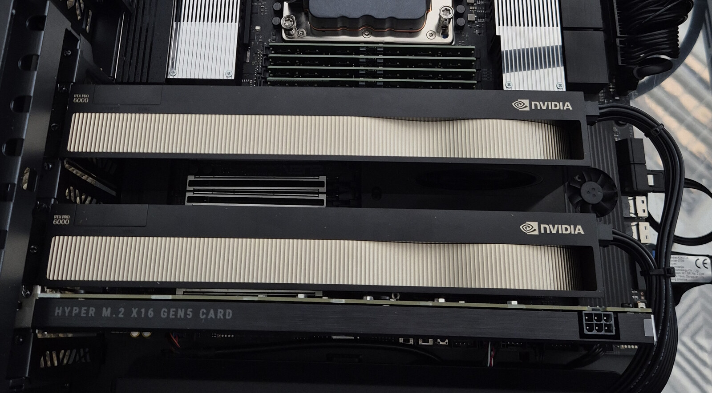

# Argodrive DS4 Kimi K3.1

## Run Kimi K3.1 Pro locally on one GPU

**This repository is the inference engine.** It already includes the ds4-based runtime, the Kimi K3/K3.1 CUDA port and its Metal port for Apple silicon, NVMe expert streaming, expert caches and weight-preparation tools. Clone and build this repository; **no separate upstream ds4 installation or Argodrive Mac app is needed**.

This is a **source release**. Model weights, NVIDIA drivers, CUDA build tools (on a Mac, the Xcode command-line tools) and Python dependencies are separate; there is currently no prebuilt installer.

### Measured results at a glance

| Hardware | Workload | Measured speed | Version and scope |
|---|---|---:|---|
| **RTX PRO 6000** (96 GB, Linux, CUDA) | Short-prompt chat: 286 prompt / 200 output tokens | **2.01–2.02 tok/s decode** | 7 November, chat drafter settings |
| **RTX PRO 6000** (96 GB, Linux, CUDA) | Raw financial text: 6 prompt / 512 output tokens | **3.77–3.79 tok/s decode** | 11 November, Qwen drafter, fp32 activations |
| **RTX PRO 6000** (96 GB, Linux, CUDA) | Long raw prompt: 512 prompt / 200 output tokens | **3.88–3.89 tok/s decode** | 11 November, Qwen drafter |
| **RTX PRO 6000** (96 GB, Linux, CUDA) | Prompt processing: 1,512-token prompt | **43 tok/s prefill** | 8 November; not output generation speed |
| **RTX PRO 6000** (96 GB, Linux, CUDA) | Long chat prompts: 6,769 / 13,167 tokens | **1.51 / 1.48 tok/s decode** | 8 November, 8k / 16k context caches |
| **MacBook Pro M5 Max** (128 GB, macOS, Metal) | Raw financial text: 6 prompt / 512 output tokens | **2.04 tok/s decode** | 9 November, Qwen drafter, fp32 activations |
| **MacBook Pro M5 Max** (128 GB, macOS, Metal) | Prompt processing: 512-token prompt | **8.4 tok/s prefill** | 9 November; not output generation speed |

**Tested hardware, not minimum requirements:**
- **RTX PRO 6000 (Linux, CUDA):** one RTX PRO 6000 Blackwell GPU with **96 GB VRAM**, **70 GiB RAM** assigned to the Ubuntu VM and **five physical NVMe devices** in three storage tiers (**four** in two tiers for the 10 and 11 November results). Context caches measured up to **16,384 tokens** using sparse attention.
- **MacBook Pro (macOS, Metal):** a MacBook Pro with an **M5 Max and 128 GB** of unified memory, its internal SSD and **two Thunderbolt 5 NVMe drives**. Contexts measured up to **2,048 tokens**.
- Both run the same engine on the same **1.45 TB of unique MXFP4 experts**, plus spine, checkpoint and replicas. **Equivalence to Moonshot’s reference implementation remains unvalidated.**

Different machines, prompts and engine versions are separate experiments, not a single controlled speed comparison. [All measurements, definitions and limits](https://argonautlabs.ai/research/kimi-k31-single-gpu.html).

### Footprint: quant, storage and memory

| | RTX PRO 6000 (Linux, CUDA) | MacBook Pro M5 Max (macOS, Metal) |
|---|---|---|
| **Experts** | 82,432 files of 17.5 MB, 1.45 TB: MXFP4 exactly as in Moonshot's checkpoint, not re-quantized | the same files |
| **Spine** (all non-expert weights) | 62 GB of GGUF Q8_0, converted from the checkpoint's BF16, held in VRAM | the same file, held in unified memory |
| **Arithmetic** | fp32 activations, full-precision attention cache, no expert skipping | the same |
| **Storage to run** | the spine and one copy of the experts, about 1.5 TB: one NVMe drive with room for both is enough | the same; the internal SSD alone is enough if it has the room |
| **Storage to prepare** | the checkpoint (about 1.56 TB) plus the outputs: plan on about 3.5 TB free; afterwards the engine reads only the spine and the expert files | the same |
| **Memory** | 96 GB of VRAM for the spine and an expert cache of about 27 GB; 70 GiB of host RAM with a 53.7 GB pinned expert pool (`DS4_K3_CACHE_RAM_GB`) | 128 GB unified: the spine, a 40 GB expert cache (`DS4_K3_CACHE_RAM_GB`) and buffers, at Metal's recommended working set (about 107 GiB) |
| **Measured storage** | a RAID0 of three NVMe drives with the 79,365 most used experts and a second NVMe with the rest plus copies; on 6–8 November also a Thunderbolt NVMe with 74,000 copies | the internal SSD with 71,866 experts and two Thunderbolt 5 NVMe drives: one with the other 10,566 plus copies of the 33,600 most used, one with a full copy |
| **Optional** | the Qwen3-0.6B drafter (about 2 GB of VRAM and 1.7 GB of host RAM); the K3.1 indexer for contexts beyond 2,048 tokens (a 357 MB file) | the drafter, on the GPU through PyTorch's MPS backend |

Decode speed mostly follows the total read bandwidth of the expert drives: more drives, or copies of the most used experts on
another drive, make it faster, and a larger expert cache means fewer reads. We haven't measured this release on a single
drive, so expect it to decode slower than the numbers above. These are the tested setups, not minimum requirements. Before
deleting the checkpoint, keep its `tiktoken.model` and `tokenizer_config.json` if you want the drafter, and cut the indexer
file out with `k31_indexer_extract.py` if you want contexts beyond 2,048 tokens.

### Get started

**First installation?** Follow the [step-by-step guide: get the engine, download and prepare the weights, then run Kimi](https://argonautlabs.ai/guides/install-kimi-k31.html). It includes copyable Linux commands and troubleshooting.

1. **Get and build this engine** using the commands below.
2. **Download and prepare the Kimi K3.1 weights** with the included [weight-preparation tools](tools/kimi-k3/README.md#weight-layout).
3. **Run Kimi locally** using the [CLI or OpenAI-compatible chat endpoint](tools/kimi-k3/README.md#build-and-run). The [Qwen drafter](tools/kimi-k3/README.md#the-optional-qwen-drafter) is optional and needs its own checkpoint and dependencies.

[Full setup and tested hardware](https://argonautlabs.ai/research/kimi-k31-single-gpu.html#reproduce) · [Configuration guide](tools/kimi-k3/README.md)

### Standard benchmarks on the RTX PRO 6000 (Linux, CUDA)

Measured on 11 November at commit bb5c53b on one RTX PRO 6000 Blackwell (96 GB), one fresh process per run, greedy, raw
prompts. The experts were on four NVMe devices, as on 10 November.

| test | prefill | decode, Qwen drafter | decode, plain |
|---|---|---|---|
| "The three main financial statements are" (6 tokens), 128 generated (tg128) | — | 2.76 tok/s | 2.06–2.07 tok/s |
| 512-token prompt, 200 generated (pp512 / tg200) | 15.7–15.9 tok/s | 3.88–3.89 tok/s | 1.55 tok/s |
| 1,512-token prompt, 128 generated (pp1512 / tg128) | 40.4–40.8 tok/s | 2.92 tok/s | 1.71 tok/s |
| the same 6-token prompt, 512 generated | — | 3.77–3.79 tok/s | 1.97 tok/s |

The 10 November release, run beside it on the same drives, decoded the 512-token generation at 3.21 tok/s with the drafter
and pp512 / tg200 at 2.98, so long, predictable text is 18 and 30 % faster: a verification block may now take up to 64 rows.
Where the drafter predicts less, nothing changed: tg128 ran at 2.76 tok/s on both, a code prompt at 2.32 on both, two everyday
prompts at 2.41 / 2.41 and 2.08 / 2.10, chat at about 2 tok/s, and plain decode is the same. Long prompts start a little sooner:
a 1,549-token prompt pass took 37.1 s against 39.2 s, and the first token of a 6,769-token and a 13,167-token chat prompt came
after 73.7 s and 134.4 s against 79.9 s and 147.2 s. On 8 November, with a fifth NVMe attached, an earlier release prefilled at
18.0 tok/s on the 512-token prompt and 43 tok/s on the 1,512-token one.

The drafter gives the same tokens as plain decoding: a block's rows run the same arithmetic as plain steps, and the logits of
2,639 positions in runs with blocks showed no differing bit. The logits also matched the 10 November release's runs bit for
bit (4,747 positions: the tests above, the failure fixtures, long context and the server). Decode depends on how predictable
the text is. The 512-token prompt is `prompt-512-tokens.txt` from the deltafin Kimi K3 benchmark.
[What changed](tools/kimi-k3/README.md#wider-drafter-blocks-and-long-prompt-read-ahead-11-november-2026)

### Standard benchmarks on a MacBook Pro M5 Max (macOS, Metal)

Since 9 November the same engine runs Kimi K3.1 Pro on a MacBook Pro with an M5 Max and 128 GB of unified memory, through
Metal, with the experts streamed from the internal SSD and two Thunderbolt 5 NVMe drives: 2.04 tok/s decode on raw
completions with the Qwen drafter (512 generated), 1.93 tok/s over 128. Measured on 9 November at commit 5560b5e, median
of three fresh processes per row, greedy, raw prompts, with the Qwen drafter:

| test | prefill | decode |
|---|---|---|
| "The three main financial statements are" (6 tokens), 128 generated (tg128) | — | 1.93 tok/s |
| 512-token prompt, 128 generated (pp512 / tg128) | 8.4 tok/s | 1.47 tok/s |
| the same 6-token prompt, 512 generated | — | 2.04 tok/s |

The Metal path computes with fp32 activations throughout, and the drafter's runs gave the same logits as plain decoding
(2,955 positions compared). Setup, drive layout and knobs: [Apple silicon](tools/kimi-k3/README.md#apple-silicon-metal).

These are the 9 November release's measurements. The 11 November release also changes three defaults on the Mac
(verification blocks of up to 64 rows, read-ahead in the prompt pass, and plain steps that issue their reads first);
measurements with them will follow here.

### Architecture and validation

[Argonaut Labs](https://argonautlabs.ai) built this Kimi K3 / K3.1 Pro port on top of Salvatore Sanfilippo's [ds4](https://github.com/antirez/ds4) at commit c97964b.
The spine is Q8_0, and its matmuls take fp32 activations. The 82,432 MXFP4 expert files stay on disk. On the GPU the spine sits in VRAM and the experts move
through a VRAM cache and a pinned RAM pool; on a Mac the spine and one expert cache share the unified memory. There's no expert skipping. The drafter is off by default; `DS4_K3_QWEN=1` turns it on
([setup](tools/kimi-k3/README.md#the-optional-qwen-drafter)).

<em>The workstation. The port runs on one of its two RTX PRO 6000 Blackwell cards (96 GB).</em>

The CUDA results come from one RTX PRO 6000 Blackwell (96 GB) in a 70 GiB VM. A RAID0 of three NVMe drives (19 GB/s) has the 79,365
hottest experts, a second NVMe (6.2 GB/s) has the rest plus some copies, and a Thunderbolt NVMe (3.7 GB/s) has another 74,000
copies. The 10 November results ran without the Thunderbolt NVMe.

The prompt pass is the interesting part. Once a prompt is a few hundred tokens long it hits most of the experts in every
layer, so the pass reads most of the model once and the time barely changes with length. For this model, prefill is a
bandwidth problem.

K3.1's sparse attention works: each of the 24 attention layers attends to the 2,048 positions its indexer scores highest, and
the selections match a float64 reference. The attention cache keeps what it needs to rebuild keys and values exactly, 105 KB
per position instead of 2.95 MB. On the RTX PRO 6000, a 6,769-token prompt takes 60 s at an 8k cache and then decodes at 1.51 tok/s; a
13,167-token prompt takes 124 s and decodes at 1.48 tok/s. Up to 2,048 tokens nothing changes. To use it, cut the indexer
weights out of the checkpoint with `tools/kimi-k3/k31_indexer_extract.py` and run with
`DS4_K3_DSA=k31-indexer.bin DS4_K3_CACHE_CAP=16384` and `-c 16384`.

The spine's activations are fp32 since 8 November. Earlier releases rounded each activation vector to int8 (one scale per 32
values) before every Q8_0 matmul, as ds4's dp4a path does: about 1e-3 per matmul against float64, enough to flip near-ties.
Of the published test prompts two answers changed: "The capital of France is" at its sixth token, and the record prompt at
512 tokens from token 356. `DS4_K3_F32_ACT=0` restores the int8 path.

Weight layout, knobs, how we measured and what is and isn't bit-identical are all in
[tools/kimi-k3/README.md](tools/kimi-k3/README.md).

    git clone --branch main https://github.com/argonautlabsai/argodrive-ds4-kimi-k3.1.git
    cd argodrive-ds4-kimi-k3.1
    make ds4 CUDA_ARCH=sm_120

## Where to find the Kimi code

**Kimi starts in [`ds4_kimi_k3.c`](ds4_kimi_k3.c) and [`ds4_kimi_k3.h`](ds4_kimi_k3.h); the `ds4_k3_*` files implement the [server](ds4_k3_serve.c) and [draft verification](ds4_k3_draft.cuh), and the Metal port is [`ds4_metal_k3.inc`](ds4_metal_k3.inc) with [`metal/k3.metal`](metal/k3.metal). Weight preparation and configuration live in [`tools/kimi-k3/`](tools/kimi-k3/README.md).** Shared ds4 runtime and CUDA code also support the port; other-model directories remain for the upstream engine.

The default branch is **`main`**. It contains the Kimi K3.1 Pro port and earlier K3 support. [Updating an existing `kimi-k3` clone](tools/kimi-k3/BRANCH-MIGRATION.md). For a fixed reproduction target, use the [8 November source tag](https://github.com/argonautlabsai/argodrive-ds4-kimi-k3.1/tree/k31-cuda-20261108).

| Start here | What it contains |
|---|---|
| [Installation guide](https://argonautlabs.ai/guides/install-kimi-k31.html) | Build, weight download and preparation, first run, troubleshooting |
| [Kimi configuration and tools](tools/kimi-k3/README.md) | Weight layout, reader settings, optional drafter, sparse attention and validation |
| [Measured results](https://argonautlabs.ai/research/kimi-k31-single-gpu.html) | Hardware, dates, workloads, timing definitions and raw JSON |
| [Upstream documentation](UPSTREAM_README.md) | The original ds4 engine and other-model instructions |

Shared engine and backend directories remain in the source tree. For this Kimi CUDA setup, follow the Kimi guide above. The separate Argodrive Mac monitoring app is optional and is not part of the installation.

## Upstream credits and documentation

This engine is built on [Salvatore Sanfilippo’s ds4](https://github.com/antirez/ds4). The original ds4 README, model instructions and acknowledgements are preserved in [UPSTREAM_README.md](UPSTREAM_README.md); the [license](LICENSE) is unchanged. Those upstream model instructions are reference material. For Kimi, use the setup in this README and [tools/kimi-k3/README.md](tools/kimi-k3/README.md).
