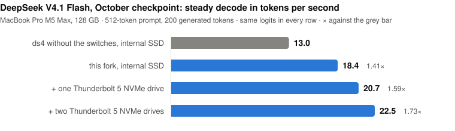

# DeepSeek V4.1 Flash on a Mac: streaming from one, two or three drives

DeepSeek V4.1 Flash does not fit in the memory of a 128 GB Mac: the October checkpoint
(`DeepSeek-V4.1-Flash-1017-MXFP4-experts.gguf`, 501.6 GB) keeps 9.4 GiB of weights resident and streams its
15,360 routed experts (17.9 MiB each) from disk into a cache. With `--ssd-streaming` the engine does that out of the
box. This directory documents the switches in this fork that make the streaming faster on Apple silicon, the numbers
they give on a MacBook Pro M5 Max, and the tools used to measure them.

All of the switches are off unless set. None of them changes a kernel, a weight or the arithmetic: every run reported
here produced the same text as the same binary without switches.

## The current numbers: 13 November 2026

<p align="center">
  <picture>
    <source media="(prefers-color-scheme: dark)" srcset="images/decode-drives-dark.svg">
    
  </picture>
</p>

MacBook Pro M5 Max (128 GB), every switch of this page on including `DS4_ARGODRIVE_DECODE_PIPELINE=4`, 4,368 cached
experts, 512-token prompt, 200 generated tokens. One session with the other applications closed: one, two and three
drives in turn, three times, every run a fresh process with the page cache of the model files dropped. All nine runs
produced the same text.

| setup | prefill (three runs) | steady decode (three runs) |
|---|---|---|
| internal SSD | 44.4 tok/s (44.0 / 44.4 / 44.5) | 18.4 tok/s (17.9 / 18.4 / 18.4) |
| internal SSD + one Thunderbolt 5 NVMe drive | 59.5 tok/s (59.6 / 59.4 / 59.5) | 20.7 tok/s (20.7 / 20.8 / 20.7) |
| internal SSD + two Thunderbolt 5 NVMe drives | 72.8 tok/s (72.8 / 73.2 / 72.7) | 22.5 tok/s (22.4 / 22.5 / 22.6) |

The same engine without any switch, on the internal SSD with its 3,600-expert cache: 17.6 tok/s prefill and 13.0
decode (12 November). `make_decode_chart.py` draws the chart. The sections below are the measurements of 12 November
that led here; they were taken without the decode pipeline unless they say otherwise.

## Measured on a MacBook Pro M5 Max (128 GB), 12 November 2026

`ds4-bench`, prompt `speed-bench/promessi_sposi.txt`, 200 generated tokens, every arm a fresh process with the page
cache of the model files dropped first, other applications open but idle. Decode is the steady rate after the first
token. Medians of three runs for the rows with switches on the internal SSD, single runs for the others; the three
runs of a row lay within 0.3 % of each other.

| setup | prompt | prefill | decode |
|---|---|---|---|
| no switches, internal SSD, 3,600 cached experts | 512 tokens | 17.6 tok/s | 13.0 tok/s |
| switches, internal SSD | 512 tokens | 41.8 tok/s | 16.4 tok/s |
| switches, internal SSD + one Thunderbolt 5 NVMe drive | 512 tokens | 55.7 tok/s | 18.3 tok/s |
| switches, Thunderbolt 5 NVMe drive only | 512 tokens | 19.2 tok/s | 11.3 tok/s |
| no switches, internal SSD | 2,048 tokens | 70.1 tok/s | 11.9 tok/s |
| switches, internal SSD | 2,048 tokens | 118.4 tok/s | 14.8 tok/s |
| switches, internal SSD + one Thunderbolt 5 NVMe drive | 2,048 tokens | 160.7 tok/s | 16.7 tok/s |
| switches, Thunderbolt 5 NVMe drive only | 2,048 tokens | 52.9 tok/s | 9.8 tok/s |
| no switches, internal SSD | 4,096 tokens | 126.9 tok/s | 12.2 tok/s |
| switches, internal SSD + one Thunderbolt 5 NVMe drive | 4,096 tokens | 249.2 tok/s | 16.5 tok/s |
| no switches, internal SSD | 8,192 tokens | 234.1 tok/s | 13.1 tok/s |
| switches, internal SSD + one Thunderbolt 5 NVMe drive | 8,192 tokens | 410.8 tok/s | 17.3 tok/s |

The rows with switches run a cache of 4,368 experts in the memory the 3,600-expert row uses (see *Memory* below).
The 4,096- and 8,192-token rows are single runs with 100 generated tokens, a 16,384-token context and 4,000 cached
experts (3,600 without switches). Up to 2,048 prompt tokens the pass reads only the experts the prompt routes to;
above that it stages whole layers, which was faster than selective reading at both sizes (249 against 236 tok/s and
411 against 357).
Without switches the same file on the Thunderbolt 5 drive alone gave 7.5 to 8.6 tok/s prefill and 8.2 to 8.5 tok/s
decode on 11 November: the drive under the model matters as much as the switches. These numbers move with the
machine: while other applications were busy on the same laptop, the two-drive decode fell from 18.3 to between 14.8
and 15.3 tok/s for a few minutes and came back.

A third drive was added later the same day: an experts-only copy on a second Thunderbolt 5 NVMe drive (see *Two or
three drives*), weights 14:6:7, with the conditional table described under *The ranking file*. The laptop was in
light use by then, which cost every arm of that session about a tenth of its decode speed, so the comparison is
within the session:

| setup (same session, 4,368 cached experts) | 512-token prompt | 2,048-token prompt |
|---|---|---|
| switches, internal SSD + one Thunderbolt 5 drive | 59.1 tok/s prefill, 16.4 decode | 163.7 prefill, 15.5 decode |
| switches, internal SSD + two Thunderbolt 5 drives | 72.3 tok/s prefill, 17.5 decode (71.9 / 72.9 / 72.3; 17.1 / 17.5 / 17.5) | 186.4 prefill, 16.5 decode |

Prompt pass only, with a 2,400-expert cache: 45.5 tok/s from the internal SSD alone, 62.3 with one Thunderbolt 5
drive, 78.2 to 78.6 with two; 129.6 at 1,024 tokens, 213.3 at 2,048 and 319.5 at 4,096 with two (102.7, 163 to 172
and 229.0 with one). The larger cache costs the prompt pass about 8 %: more experts are copied into it per layer.

A three-turn chat through `ds4-server` (831, 1,626 and 1,638 prompt tokens; 160, 160 and 80 generated; temperature 0)
took 21.5, 23.0 and 17.4 s per turn with the switches on two drives and 49.8, 51.6 and 41.7 s without switches on the internal
SSD. The three answers were identical in both runs. The server re-reads the whole conversation on every turn (the
thinking tokens are not part of the next prompt), so in a chat the prompt pass is most of the time.

## The switches

Reading (`argodrive_read.h`, the reader in `ds4_metal.m`):

| switch | effect |
|---|---|
| `DS4_ARGODRIVE_PRIMARY_NOCACHE=1` | routed experts are read uncached through their own descriptor instead of through the page cache |
| `DS4_ARGODRIVE_REPLICAS=/abs/path*W[,/abs/path*W]` | up to two byte-identical copies of the model file on other drives; every expert read is split across the drives in 256 KiB blocks in proportion to the weights |
| `DS4_ARGODRIVE_PRIMARY_WEIGHT=W` | the first drive's weight (default 2) |
| `DS4_ARGODRIVE_DECODE_WEIGHTS=a,b[,c]` | a different split for decode loads |

Prompt pass (staging the routed experts of each layer into two staging sets):

| switch | effect |
|---|---|
| `DS4_ARGODRIVE_PREFILL_SPLIT=1` | the staged prompt pass; needs the reader (one of the two switches above) |
| `DS4_ARGODRIVE_PREFILL_SELECTIVE=1` | read only the experts the prompt routes to, after the router has run |
| `DS4_ARGODRIVE_PREFILL_SELECTIVE_MAX=N` | selective up to N prompt tokens in one chunk (default 512; 2,048 measured here) |
| `DS4_ARGODRIVE_PREFILL_AHEAD=1`, `DS4_ARGODRIVE_PREFILL_LANES=8` | read the next layer while this one computes; reads in flight per staged tensor |
| `DS4_ARGODRIVE_PREFILL_HOT=384`, `DS4_ARGODRIVE_HOTLIST=<file>` | before the router's answer is known, read the next layer's likeliest experts in the order of a ranking file |
| `DS4_ARGODRIVE_COOC=<file>` | order that read-ahead by what this prompt routed to in the layer before, from a table of layer-to-layer counts; the ranking file stays the fallback |
| `DS4_ARGODRIVE_PREFILL_CACHE_COPY=1` | experts the cache already holds are copied from memory instead of read again |
| `DS4_ARGODRIVE_ENGRAM_PREFETCH_MIN=1`, `DS4_ARGODRIVE_ENGRAM_BATCH_READERS=128` | start the Engram table reads early and keep more of them in flight |

Decode:

| switch | effect |
|---|---|
| `DS4_ARGODRIVE_CACHE_SHARE=1` | the staging sets stay allocated and lend their 768 expert positions to the cache between prompt passes |
| `DS4_ARGODRIVE_GAP_KEEPALIVE=2`, `DS4_TP_KEEPALIVE_TGS=1`, `DS4_TP_KEEPALIVE_ITERS=300000` | a small kernel keeps the GPU out of its low-power states between the command buffers of a token |
| `DS4_ARGODRIVE_DECODE_PIPELINE=4` | the decode step stops ending its command buffer at every layer's router, so the GPU is no longer left waiting for the host; see *The decode pipeline* |

`m5max-two-drives.env.example` is the set used for the two-drive rows. For one drive, leave out the two lines that
name the replica; for three, name both replicas in `DS4_ARGODRIVE_REPLICAS`, separated by a comma.

## Two or three drives

A replica must hold the same bytes as the model file: the reader checks size and identity of the file, not content,
and a read is assembled from blocks of every drive. Copy the file, then compare a checksum of the copy with the
published one before using it. Weights should follow what the drives deliver together; 7 for an M5 Max internal SSD
against 3 for an 80 Gb/s Thunderbolt 5 NVMe enclosure was the best of the splits tried here, for the prompt pass and
for decode alike, and 14:6:7 with a second, slightly faster enclosure.

A replica does not need the whole file. The reader only ever asks a replica for bytes of the routed expert tensors,
288.8 GB of the 501.6 GB here, so `make_replica.py` writes a sparse file of the model's size that holds exactly
those tensors at their own offsets, reads every range back and compares it with the source:

```
python3 tools/deepseek-v41/make_replica.py /path/to/model.gguf /Volumes/ThirdDrive/model.gguf
```

A hole in a sparse file reads as zeros without an error, so the reader looks for holes when it opens a replica and,
if it finds any, refuses every read that touches one: the run stops instead of computing with zeroed weights. A
replica that is all holes fails at the first layer of the prompt pass.

## Memory

A decode step is about 30 ms of GPU work, which is close to what the memory bandwidth of the machine allows for
13 GB of weights per token, plus about 1.2 ms for every expert that is not in the cache. The cache size is therefore
the remaining lever, and it is bounded by memory:

| cached experts | experts loaded per decode token |
|---|---|
| 3,600 | 20.1 |
| 4,368 | 14.9 |
| 4,800 | 12.3 |
| 5,200 | 10.5 |
| 6,000 | 7.8 |

(route replay of a 512-token prompt and 600 generated tokens with `route_cache_sim.py`; the engine measured 20.4 and
15.6 at the first two sizes.)

The staged prompt pass needs two staging sets, 13.45 GiB for this model. Without `DS4_ARGODRIVE_CACHE_SHARE` they
are allocated on top of the cache for every prompt pass. With it, `--ssd-streaming-cache-experts N` is the whole
budget: the prompt pass runs with N − 768 cached experts, decode with N, and the resident size does not move between
the two (86.5 GiB here at N = 4,368: 76.5 GiB of experts, 9.4 GiB of resident weights, the rest buffers). Choose N so
that this fits beside whatever else the machine runs; a cache that pushes the system into swap is slower than a
smaller one.

There is a second bound. The engine keeps the resident weights locked in memory only while they and the cache
together stay under seven eighths of Metal's recommended working set less the context buffers, rounded down to a
GiB: 92 GiB on this machine at a 4,096-token context, which is 4,719 experts (4,434 at a 16,384-token context).
Measured on the 512-token benchmark with two drives:

| cached experts | prefill | decode | |
|---|---|---|---|
| 4,368 | 55.7 tok/s | 18.3 tok/s | the rows above |
| 4,700 | 55.6 tok/s | 19.1 tok/s | 93.5 GiB planned; needs about 7 GiB more free memory than 4,368 |
| 4,800 | 31.0 tok/s | 19.3 tok/s | past the bound: the resident weights become pageable and the prompt pass slows |

## The decode pipeline

A streamed decode step has to know which six experts a layer's router chose before it can bind them. The stock step
therefore ends its command buffer at every router, waits for the GPU, reads the ids and opens a new buffer. Each of
those 40 round trips a token leaves the GPU without work while the host wakes and the next buffer is scheduled, and
when an expert is missing the GPU also waits for the read while the host searches the cache for an entry to give up.

`DS4_ARGODRIVE_DECODE_PIPELINE=<level>` removes those waits. The levels are cumulative:

| level | what changes |
|---|---|
| 1 | a one-thread kernel behind the router copies the six ids to a mailbox; the host commits the buffer without waiting for it and polls the mailbox, while the GPU goes on with the shared expert |
| 2 | the routed experts are committed as soon as they are encoded, and the host encodes the next layer meanwhile |
| 3 | when some of the six experts have to be read, the gate/up work of the cached ones is committed before the reads start and runs during them |
| 4 | the cache's search for the entry to give up runs while the host waits for the mailbox; a miss then takes the entry the search would have chosen at that moment |

No weight, id, kernel or order of operations changes. At level 3 the cached experts' gate/up work is the stock
kernel dispatched over fewer of its six slots, which are independent of each other in that kernel. The ids the host
acted on are compared with a per-layer record the GPU wrote, once all of a token's command buffers have completed,
and a difference fails the step. If the mailbox has not filled after 50 ms the step waits for the GPU and reads the
ids the stock way. Cached experts stay protected the way the engine already protects them: an entry bound in a
committed buffer cannot be evicted until that buffer has been waited for.

Checked on 12 November: the hash of every decode step's full logits (`DS4_BENCH_DECODE_LOGITS_HASH=1`) is the same
with level 4 as from the build without this code, on the 512-token benchmark prompt (200 and 600 generated tokens),
at 2,048 and 4,096 prompt tokens, on English prose and on C code, 1,500 steps in all, and at each of the levels 1 to
3 on the benchmark prompt. The three-turn chat gave the same three answers. Over all runs of the day the mailbox
was polled 364,000 times and fell back to the stock readback twice, in runs whose logits were among those compared;
every layer's ids matched the GPU's record.

Measured the same day, off and on alternating from one binary, 512-token prompt, 200 generated tokens, steady
decode. With the 4,368-expert cache of the tables above:

| drives | switch off | `DS4_ARGODRIVE_DECODE_PIPELINE=4` |
|---|---|---|
| internal SSD + one Thunderbolt 5 drive | 17.1 / 17.2 tok/s | 20.1 / 20.2 tok/s |
| internal SSD + two Thunderbolt 5 drives | 19.3 / 18.0 tok/s | 21.4 / 21.5 tok/s |

(prefill 59.2 to 59.7 tok/s on two drives and 69.1 to 72.6 on three, the same with and without.) And with a
2,400-expert cache, measured earlier when the laptop had about 64 GiB free:

| drives | switch off | `DS4_ARGODRIVE_DECODE_PIPELINE=4` |
|---|---|---|
| internal SSD | 10.9 tok/s | 11.9 tok/s |
| internal SSD + one Thunderbolt 5 drive | 12.6 tok/s (12.5 / 12.6 / 12.6) | 14.4 tok/s (14.4 / 14.4 / 14.4) |
| internal SSD + two Thunderbolt 5 drives | 13.8 tok/s (13.7 / 13.8 / 13.9) | 16.3 tok/s (16.1 / 16.3 / 16.4) |
| the same, 2,048-token prompt | 13.5 tok/s | 15.2 tok/s |

By level, on two drives: 12.5 off, 13.1 at level 1, 13.2 at level 2, 13.7 at level 3, 14.3 at level 4. The time spent
waiting for the router's answer fell from 33 to 26 ms a token and the eviction search from 2 ms to nothing; the
expert reads (40 ms a token at this cache size, 34 loads) are untouched, which is why the gain grows with the number
of drives. The prompt pass does not change. The three-turn chat went from 25.2, 28.7 and 20.0 s a turn to 23.6, 26.6
and 19.1 s (2,400-expert cache, two drives), and took 19.9, 21.9 and 15.4 s on three drives. The first table of
this page was measured without the switch.

Two things to know. While a token is computed one CPU core polls the mailbox instead of sleeping. And the keep-alive
kernel is still needed: with the pipeline on and the keep-alive off the same run fell from 13.7 to 10.7 tok/s.

## The ranking file

`hotlists/deepseek-v4.1-flash-1017-readahead.txt` ranks each layer's experts by how often 22 prompts of 512 tokens
routed to them: nine slices of *I Promessi Sposi* from 100 KB into the book onward, eight slices of the two English
long-context prompts in `tests/`, three C sources, the Makefile and a Metal shader, all from this repository. None
overlaps a measured prompt (the benchmark reads the head of the book). It only decides the order of the read-ahead; a
different list changes speed, never output. With it the read-ahead had 41 % of a layer's experts in place before the
router answered on the benchmark prompt, 36 % on English prose and 34 % on C code.

`hotlists/deepseek-v4.1-flash-1017-cooc.bin` is the conditional table for `DS4_ARGODRIVE_COOC`, built from the same
22 prompts: for every pair of consecutive layers, how often a token that routed to an expert of one layer routed to
each expert of the next. While a layer computes, the engine scores the next layer's experts with the counts of the
experts this prompt has just routed to, so the read-ahead follows the prompt instead of an average over all text. On
the three held-out prompts it had 37 %, 29 % and 34 % of the routed experts in place against 31 %, 25 % and 24 % for
the ranking alone, and the prompt pass (two drives, measured on 12 November in a later session with a 2,400-expert
cache, prompt pass only) went from 57.3 to 58.6 tok/s up to 62.2 to 62.4 on the benchmark prompt, from 51.3 to 56.4
on C code, from 48.6 to 50.1 on English prose and from 97.3 to 102.7 at 1,024 tokens; at 2,048 tokens two pairs gave
162.8 against 172.2 and 163.6 against 163.8. The text was the same in every pair. The table above was measured
without it.

To build one for another model or corpus:

```
python3 tools/deepseek-v41/make_corpus.py . /tmp/corpus
# for each file: one 512-token prompt pass with DS4_ARGODRIVE_PREFILL_IDS_DUMP=/tmp/dumps/<name>.txt
python3 tools/deepseek-v41/make_hotlist.py my-ranking.txt /tmp/dumps/*.txt
# the conditional table needs per-token dumps: DS4_ARGODRIVE_PREFILL_TOKENS_DUMP=/tmp/tokens/<name>.txt
python3 tools/deepseek-v41/make_cooc.py my-table.bin 40 384 /tmp/tokens/*.txt     # needs NumPy
```

Never include a prompt you are going to measure.

## Tools

- `make_corpus.py`, `make_hotlist.py`, `make_cooc.py`: the ranking and the conditional table, as above.
- `make_replica.py`: an experts-only sparse replica for a second or third drive, verified against the source.
- `make_decode_chart.py`: the decode chart at the top of this page, as one SVG for light and one for dark pages.
- `route_cache_sim.py`: replays a recorded run (`DS4_ARGODRIVE_PREFILL_TOKENS_DUMP`, `DS4_MOE_RECORD_SELECTED_IDS`)
  through a model of the expert cache, to size a cache or compare eviction rules without running the engine. It
  reproduced the engine's loads per token within 1 % at three cache sizes.

## CUDA: one GPU that streams its experts

The CUDA backend carries the switches that have served a DeepSeek V4.1 Flash endpoint on one RTX PRO 6000 (96 GB)
since October 2026. They are off unless set, and with none set the expert loader takes upstream's path.

| switch | effect |
|---|---|
| `DS4_CUDA_HOST_EXPERT_CACHE_GB=N`, `DS4_CUDA_HOST_TIER_LOAD=<ranking>`, `DS4_CUDA_HOST_TIER_DUMP=<file>` | a pinned host-RAM tier of routed experts behind the VRAM cache, preloaded from a ranking; the dump writes the ranking a session observed |
| `DS4_CUDA_POOL_FIRST=1`, `DS4_CUDA_POOL_EVICT_BIAS=N` | a miss is served from the host tier before the drive; experts the tier still holds are evicted from VRAM first |
| `DS4_CUDA_PARALLEL_EXPERT_READ=1`, `DS4_CUDA_EXPERT_READERS=N`, `DS4_CUDA_READ_THREADS=N`, `DS4_CUDA_STAGE_RING=N`, `DS4_CUDA_UPLOAD_ON_READY=1` | several readers per load, a larger staging ring, and the upload issued by the reader that finished the read |
| `DS4_CUDA_REPLICAS=/abs/path*W`, `DS4_CUDA_PRIMARY_WEIGHT=W` | reads split between the model file and a full or partial copy on a second drive |
| `DS4_CUDA_SHARED_ASYNC=1` | the shared expert runs on a side stream while the host loads the routed ones |
| `DS4_CUDA_PREFILL_WAVES=1`, `DS4_CUDA_PREFILL_COLD=1` | prompt pass: resident experts first, and prompt-pass fills marked cold for the decode cache |
| `DS4_CUDA_MOE_Q4_MMA_WIDE=1` | the wide tensor-core tile kernels for Q4_K experts |
| `DS4_CUDA_VRAM_RESERVE_MB=N`, `DS4_STREAMING_CACHE_IGNORE_HOST_BUDGET=1` | how much VRAM stays free, and a VRAM cache sized by VRAM instead of by host RAM |

Checked on 11 November 2026 on the RTX PRO 6000 with the Q4_K file (518.6 GB) and a 3,869-expert VRAM cache: three
300-token chat prompts and one 1,556-token prompt at temperature 0 gave the same text from the build that had been
serving, from this tree with the same switches, from this tree without the side stream, and from this tree with no
switches. Decode on the three short prompts:

| build | decode |
|---|---|
| the build that had been serving (upstream of 14 September plus these changes) | 10.98 / 10.71 / 10.23 tok/s |
| this tree, the same switches | 11.99 / 11.68 / 10.60 tok/s |
| this tree, without `DS4_CUDA_SHARED_ASYNC` | 11.29 / 10.99 / 10.34 tok/s |
| this tree, no switches (the engine fits the VRAM cache to host RAM: 1,330 experts) | 3.18 / 2.94 / 2.47 tok/s |

The 1,556-token prompt took 25.5 to 25.7 s to process with the switches and 47.8 s without. The Kimi K3.1 path gave
the logits of its published references on the same binary (840 positions).

## What was measured and left out

- Committing the rest of a reading layer's routed work before the reads return, behind a kernel that waits on the
  GPU for the host's release (the engine's inline tensor-parallel gate, used for reads): 14.35 / 14.43 / 13.92 tok/s
  against 14.22 / 14.05 / 14.23 without it, same text. Under 1 % and inside the spread of the runs, for a kernel
  that reads memory the host is writing; left out.
- Splitting the down projection so that the cached experts' share runs during the reads: the six experts are summed
  lane by lane inside one kernel, so a split needs two new kernels whose rounding order would have to be shown equal
  to the fused one's, for about 1 %. Not built.

- An eviction rule that ages use counts continuously: 3 to 8 % fewer loads than the engine's rule on three recorded
  runs, more loads with a long half-life on English prose. The engine's rule stays. Evicting with knowledge of the
  future (Belady's bound) would load about 40 % fewer experts, so the gap is foresight, not the rule.
- Reading a layer's experts one layer early: guessing them from co-occurrence statistics named 1 % of the experts
  that were missing; applying the next layer's router to this layer's input named 41 % of them, and 77 % of the
  experts it would have fetched went unused.
- More staging lanes than 8, more decode reader threads than the default 9, and decode splits other than the prompt
  pass's: no gain.
- DSpark, the draft-and-verify decode: with the MXFP4-experts file and SSD streaming on Metal its verify step stops
  with "model range is not covered by mapped model views", in unmodified ds4 of 3 November as well as in this tree
  (the batched verify reads cached experts only for the Q2 file). ds4 also states that DSpark's output can differ
  from one-token decode, and `--dspark-strict` keeps target-only decode, so it lies outside the same-output rule
  the switches here follow. The support file for the October checkpoint converts and verifies with
  `gguf-tools/deepseek41_dspark.py` from shards 44 to 46 of `deepseek-ai/DeepSeek-V4.1-Flash-1017`.
- The two-wave routed MoE of the earlier fork: with two drives the 512-token prompt pass reads 151 GB in 8.2 s on
  drives that deliver about 18 GB/s together, so the drives are busy the whole time and there is nothing left for
  it to overlap; on one drive it measured 19.2 against 19.1 tok/s.
